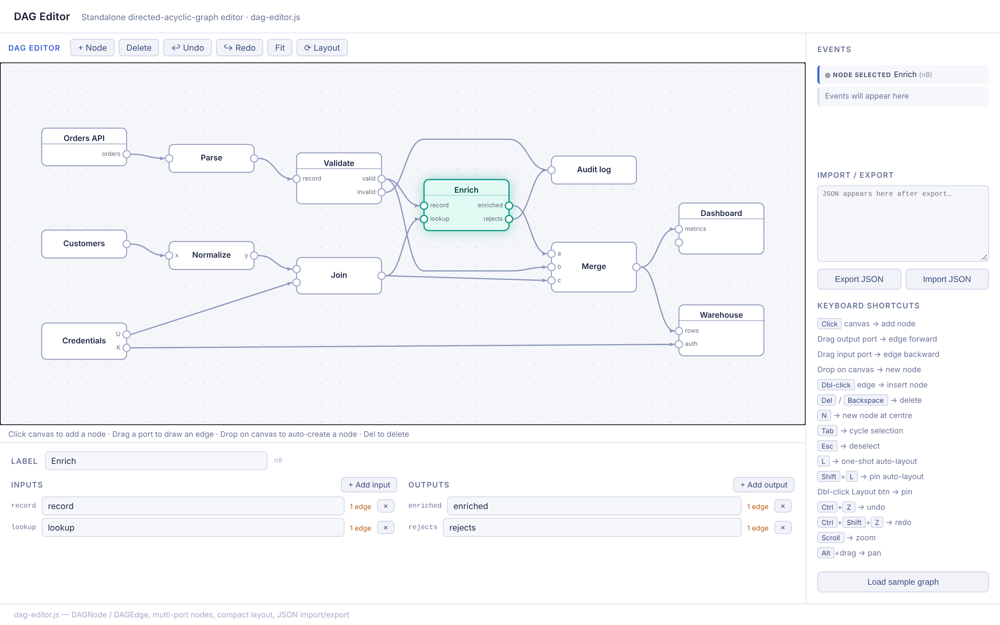

# DAGEditor

A standalone, zero-dependency interactive editor for directed acyclic graphs. Drop it into any page — no build step, no npm, no frameworks.



* [Live DAGEditor demo page](https://nickzoic.github.io/dag-editor/dag-editor-demo.html)
* [Github Repo](https://github.com/nickzoic/dag-editor/)

[](https://github.com/nickzoic/dag-editor/actions/workflows/test.yml)

## Files

| File | Purpose |
|------|---------|
| `dag-editor.js` | All logic — `DAGNode`, `DAGEdge`, `DAGEditor` classes |
| `dag-editor.css` | All styles and design tokens |
| `dag-editor-demo.html` | Working demo (requires the two files above in the same directory) |
| `test/`, `package.json` | The unit and browser tests, and the (development-only) tools they use — see [Running the tests](#running-the-tests) |
| `screenshot.png` | The screenshot at the top of this page |

## Quick Start

```html
<link rel="stylesheet" href="dag-editor.css">

<div id="my-graph" style="height: 100%;"></div>

<script src="dag-editor.js"></script>
<script>
  const editor = new DAGEditor(
    document.getElementById('my-graph'),
    (event) => {
      console.log(event.type, event.node ?? event.edge);
    }
  );
</script>
```

Open `dag-editor-demo.html` in a browser (with `dag-editor.js` and `dag-editor.css` in the same folder) to see a fully working example. It opens with a 12-node sample graph — chosen to show nodes with no, one and several inputs and outputs, compact and expanded nodes, and labelled and unlabelled ports — which is laid out automatically once it has loaded. The graph editor fills the page height, with a **node editor pane** below it (edit the selected node's label and add, remove and label its ports), plus an event log and JSON import/export.

---

## Nodes and Ports

Each node has zero or more named **input ports** (left side) and zero or more named **output ports** (right side). Ports have an `id` and an optional `label`.

A node renders in a **compact** layout — no header, label centred, ports stacked down the sides — as long as none of its port labels is longer than one user-perceived character. Characters are counted with `Intl.Segmenter`, so `x̅` (an `x` plus a combining overline), an accented letter written with a combining accent, a flag or a ZWJ emoji sequence each count as one. Any number of unlabelled or one-character-labelled ports stays compact. If any port label is longer, the node **expands**: the label gets its own header above a divider, and each port shows its full label inside the body. (The node's own label is not counted; it wraps instead.)

Long node labels wrap onto several lines (words wider than a line are broken), and the node grows taller to fit.

```js
// Create a node with custom ports
editor.addNode('Transform', 100, 80, {
  inputs:  [{ id: 'raw',  label: 'raw data' }],
  outputs: [{ id: 'out',  label: 'result'   }],
});

// Default: one input port ("in") and one output port ("out")
editor.addNode('Filter');
```

The canvas has no built-in label editor — the host page supplies the UI and drives these methods (the demo's node editor pane is a working example):

```js
editor.setNodeLabel('n3', 'Validate input');
const port = editor.addPort('n3', 'output', { label: 'warnings' });  // id auto-generated: "out", "out2", …
editor.setPortLabel('n3', 'output', port.id, 'warn');
editor.removePort('n3', 'output', port.id);   // also removes every edge attached to that port
```

---

## Mouse Interactions

| Gesture | Action |
|---------|--------|
| Click empty canvas | Create a new node |
| Click node | Select it |
| Click edge | Select it |
| Drag node body | Move node |
| Drag output port → canvas | Draw edge; create destination node on drop |
| Drag output port → input port or node | Connect edge |
| Drag input port (reverse) | Same, in reverse direction |
| Double-click edge | Insert a new node on the edge |
| Scroll | Zoom |
| Alt + drag | Pan |

---

## Keyboard Shortcuts

| Key | Action |
|-----|--------|
| `Delete` / `Backspace` | Delete selected node or edge |
| `Escape` | Deselect |
| `N` | New node at canvas centre |
| `Tab` / `Shift+Tab` | Cycle node selection |
| `L` | One-shot auto-layout |
| `Shift+L` | Toggle pinned auto-layout |
| `Ctrl+Z` | Undo |
| `Ctrl+Shift+Z` | Redo |

---

## Orientation: landscape and portrait

If the container is **taller than it is wide**, the graph is shown *flipped*: the X and Y axes are swapped, so each node has its inputs on its top edge and its outputs on its bottom edge, and the strata run from top to bottom. Each node keeps its position relative to the others, so a node near the top of a wide pane ends up near the left of a tall one. Text always stays upright: each port label sits just inside the edge, under (or over) its port. The ports on each edge are spread evenly across the node — one in the middle, two at thirds, three at quarters, and so on, whatever their labels — and a node is made wider if its labels need the room.

- Whenever the container is resized, the graph is re-fitted to the new size and the orientation is chosen again (a `ResizeObserver` watches the container).
- Flipping affects only how the graph is drawn. `node.x` and `node.y`, and so `toJSON()`, `exportJSON()` and `getGraph()`, are **always in the unflipped, left-to-right orientation**; `addNode(label, x, y)` and `fromJSON()` take positions in that orientation too.
- `editor.flipped` tells you which orientation is showing.
- Auto-layout leaves room for both orientations, so a graph laid out in one looks right in the other.

## Auto-Layout

Click **⟳ Layout** (or press `L`) for a one-shot animated layout. Nodes are arranged in columns left to right by their depth in the graph, ordered within each column to reduce edge crossings, and positioned so connected ports line up. Nodes never overlap, and long edges are given their own lane between nodes where they can. The nodes glide into place (about half a second) while the view stays fitted to the window. The result is deterministic: the same graph and arrangement always lay out the same way.

**Double-click** the Layout button (or press `Shift+L`) to **pin** auto-layout: the graph will re-layout automatically whenever edges are added or removed. The button pulses teal while pinned.

---

## API

### Constructor

```js
const editor = new DAGEditor(containerEl, onChange);
```

- `containerEl` — any `HTMLElement`. The editor fills it.
- `onChange(event)` — called on every graph change (see Events below).

### Methods

```js
// Graph manipulation
editor.addNode(label, x?, y?, { inputs?, outputs? })  // → DAGNode
editor.addEdge(fromNodeId, fromPortId, toNodeId, toPortId)  // → boolean
editor.deleteNode(id)
editor.deleteEdge(id)

// Node and port editing  (direction is 'input' or 'output')
editor.setNodeLabel(nodeId, label)                    // → boolean
editor.addPort(nodeId, direction, { id?, label? })    // → port | null
editor.removePort(nodeId, direction, portId)          // → boolean; removes attached edges too
editor.setPortLabel(nodeId, direction, portId, label) // → boolean

// Query
editor.getGraph()  // → { nodes: DAGNode[], edges: DAGEdge[] }

// Import / export
editor.toJSON()          // → plain object (schema v2)
editor.fromJSON(data)    // load from plain object → this
editor.exportJSON(indent?)  // → JSON string
editor.importJSON(json)     // parse and load → this
editor.loadGraph(data)   // load plain object (v1 or v2), fit view

// View
editor.autoLayout(active)  // programmatic layout control
editor.flipped             // true while the graph is shown flipped (container taller than wide)
editor.undo()
editor.redo()
editor.destroy()           // remove all DOM
```

### Events

```js
{ type: 'created',      node: DAGNode }  // node created
{ type: 'selected',     node: DAGNode }  // node selected
{ type: 'deselected',   node: DAGNode }  // node no longer selected (another selected, cleared, graph replaced, undo/redo)
{ type: 'updated',      node: DAGNode }  // label changed, or a port added / removed / relabelled
{ type: 'deleted',      node: DAGNode }  // node deleted
{ type: 'edge-created', edge: DAGEdge }  // edge created
{ type: 'edge-deleted', edge: DAGEdge }  // edge deleted
```

Removing a port that has edges fires `edge-deleted` for each, then `updated`.

`DAGNode` properties: `id`, `label`, `x`, `y`, `inputs[]`, `outputs[]`  
`DAGEdge` properties: `id`, `fromNodeId`, `fromPortId`, `toNodeId`, `toPortId`

---

## JSON Schema

```json
{
  "version": 2,
  "nodes": [
    {
      "id": "n1",
      "label": "Source",
      "x": 40, "y": 100,
      "inputs":  [],
      "outputs": [{ "id": "data", "label": "data" }]
    }
  ],
  "edges": [
    {
      "id": "e1",
      "fromNodeId": "n1", "fromPortId": "data",
      "toNodeId":   "n2", "toPortId":   "raw"
    }
  ]
}
```

Version 1 graphs (single implicit port per node, `from`/`to` edge fields) are automatically upgraded on load.

---

## Theming

All colours are CSS custom properties on `:root` in `dag-editor.css`:

```css
:root {
  --dag-bg:          #0f1117;  /* canvas background    */
  --dag-node-fill:   #1e2538;  /* node background      */
  --dag-node-stroke: #3a4466;  /* node border          */
  --dag-node-sel:    #4a7cff;  /* selection blue       */
  --dag-node-text:   #c8d0f0;  /* label text           */
  --dag-edge:        #3a4466;  /* edge stroke          */
  --dag-accent:      #4a7cff;  /* selected edge        */
  --dag-draft:       #ff9f4a;  /* draft edge (orange)  */
  --dag-port:        #4a7cff;  /* port highlight       */
  /* … see dag-editor.css for the full list */
}
```

---

## Running the tests

The component has no dependencies. The tests do: they need **Node.js 22.22 or later** (or 24.15+), and npm is used only to install the test tools ([jsdom](https://github.com/jsdom/jsdom), [puppeteer-core](https://pptr.dev/) and [c8](https://github.com/bcoe/c8)):

```sh
npm install        # once.  (npm ci installs exactly what package-lock.json says)
npm test           # everything
```

| Command | What it runs |
|---------|--------------|
| `npm test` | all the tests: unit, then browser |
| `npm run test:unit` | unit tests only — about 40 seconds, no browser needed |
| `npm run test:browser` | browser integration tests only — needs Chrome or Chromium |
| `npm run coverage` | all the tests with code coverage; **fails if coverage drops below the thresholds** in `.c8rc.json` |
| `npm run coverage:unit`, `npm run coverage:browser` | coverage of just one kind, with no threshold |

To run part of the suite, pass options to the test runner after `--`, or run a file directly:

```sh
npm run test:unit -- --test-name-pattern="flip"      # tests whose names match
node --test test/unit/layout.test.js                 # one file
```

### What is tested

* **Unit tests** (`test/unit/`) load `dag-editor.js` into [jsdom](https://github.com/jsdom/jsdom) and exercise the whole API: building graphs and the rules that keep them valid (no self-loops, duplicates or cycles), deleting with edge bridging, port editing, undo and redo, import and export (including version 1 graphs), node sizing and label wrapping, counting user-perceived characters (with and without `Intl.Segmenter`), edge curves, auto-layout, orientation and resizing, and the mouse and keyboard handlers. They also apply long **random sequences of edits** and lay out random graphs, checking after every step that the graph is still a valid DAG, that what is drawn matches the model, that nothing overlaps in either orientation, and that a layout is repeatable.
* **Browser tests** (`test/browser/`) drive the demo page in a real Chrome with [puppeteer-core](https://pptr.dev/), using real pointer, keyboard and wheel input. They check what jsdom cannot: text measured by the browser (so wrapped labels and port labels really fit), CSS states (hover, selected, port rings), flipping and re-fitting as the window is resized, the demo's full-height layout and node editor, and the event log and import/export.

jsdom does no layout, so the unit tests give the container a size, and replace the clock and `requestAnimationFrame` with a manual clock that runs animations instantly. Helpers for both kinds of test are in `test/helpers/`.

### The browser tests

They need Chrome or Chromium installed. The usual locations are searched; otherwise say where it is:

| Setting | Effect |
|---------|--------|
| `CHROME_PATH=/path/to/chrome` | use this browser |
| `PUPPETEER_HEADLESS=shell` | for a `chrome-headless-shell` build (the default is Chrome's own headless mode) |
| `HEADED=1` | show the browser window while the tests run |

```sh
CHROME_PATH=/usr/bin/chromium npm run test:browser
```

### Coverage

`npm run coverage` prints a table and writes a report to `coverage/`: open `coverage/index.html` to see which lines are not covered, or use `coverage/lcov.info` with other tools. The unit tests and the browser tests both contribute: the browser's own V8 coverage of `dag-editor.js` is collected and merged with the unit tests', so code that only runs in a real browser (such as text measurement) counts.

### Continuous integration

[`.github/workflows/test.yml`](.github/workflows/test.yml) runs on every push and pull request: the unit tests on Node 22 and 24, and the browser tests with coverage on Node 22 using the Chrome that comes with GitHub's runners. The run fails if any test fails or coverage falls below the thresholds. The coverage report is attached to each run as the `coverage-report` artifact, with a summary on the run's page.

## Origin

This code is almost entirely generated by [Claude](https://claude.ai/) and I'm not pretending otherwise.

It's inspired by the DAG editor part of [CountESS](https://countess-project.github.io/) but is an entirely
new implementation and will hopefully be useful for other projects as well.
It is [licensed CC0](LICENSE).

The full behavioural requirements that this component was designed to satisfy are in [`dag-editor-requirements.md`](dag-editor-requirements.md).
